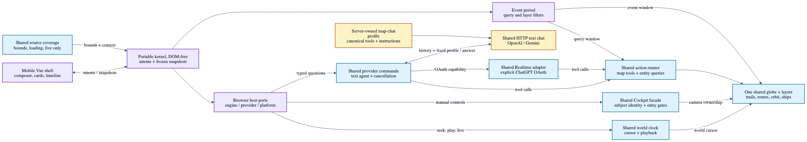

# GEV mobile interface: interview brief

Prepared November 10, 2026 for Charles Richardson (Rich).
Current-main candidate: `codex/mobile-interview-latest-20261111`.
It includes upstream `origin/main` at `632da1ce`, PRs #1654, #1655, #1656,
#1662 and #1680, and the original mobile work through `b6e1c4ee`.
The guarded iPhone rehearsal remains on the tested `codex/mobile-interview-ready`
build at `7bde248a`.

## A 60-second opening

> GEV already has a strong globe, live data, tracking and camera engine. For a phone,
> I wanted to reduce how much interface someone must navigate before doing something
> useful. The approach was one composer over the same globe, with contextual answers
> and sessions that restore the view an investigation left behind.
>
> We reused the existing actions rather than building a second geospatial application.
> The interaction logic lives in a kernel with explicit intents and plain-data snapshots;
> the browser shell supplies the rendering and platform capabilities. That makes the
> behavior testable and leaves a path to another shell later.
>
> Claude helped implement and iterate on the work. My responsibility is to understand
> the choices, review the behavior and be clear about the limits: this is mobile web,
> with device-local sessions and partial historical support. Physical-phone validation
> and a durable beta are separate readiness milestones.

## What the original work contains

These are eight feature/fix commits from November 4–7. Two additional commits merged
upstream updates; they are integration work, not additional product features.

| Original commit | Result                                                                         |
| --------------- | ------------------------------------------------------------------------------ |
| `b98fcbcc`      | Earthquake discs honor a time window and magnitude floor.                      |
| `924506ef`      | A server route supplies place-specific daily weather from Open-Meteo.          |
| `546120f7`      | Hosts can keep layer changes local to a visit.                                 |
| `7d77f131`      | Chat becomes a mode of the existing page, with sessions, answers and timeline. |
| `f5cab063`      | Automated import rules keep the chat kernel independent of the page.           |
| `5721263a`      | The composer retains its send button on narrow phones.                         |
| `11c29fa5`      | Desktop and chat share layer groups, including Wildlife.                       |
| `b6e1c4ee`      | Chat exposes shared layer chips, switches and sliders.                         |

The inherited phone tab bar and borrowed-panel bottom sheets also remain available
through Panels mode. They predate these commits.
The implementation overview is in [CURRENT-STATE.md](CURRENT-STATE.md#chat-view--november-4-2026).

## Decisions, reasons and tradeoffs

### Keep one globe and add a different interaction shell

Chat lives at `/`, uses the existing globe, and can switch back to Panels. Phones
default to Chat unless a URL or saved preference selects otherwise. `?ui=chat` and
`?ui=panels` make demonstrations reproducible; the old `/mob` address still works.
This preserves existing features and avoids maintaining a second engine. The cost
is explicit coordination between exclusive surfaces, panel preferences and time.

Read: [mode selection and lifecycle](../src/standalone/chatView.js),
[page startup](../src/main.js), [exclusive-surface styles](../src/ui/styles/chat-view-mode.css).

### Put interaction behavior behind intents and snapshots

The Vue interface sends `act(name, ...args)` and renders frozen, serializable
snapshots. The kernel takes engine, host and agent ports. Its own modules import
neither DOM globals, Cesium nor Vue; boundary checks enforce this rule.
This gives Node tests direct control over cancellation, sessions and answers, and
allows another shell to use the same contract. A native bridge has not been built;
portability is an architectural property, not a delivered native application.

Read: [kernel](../src/chatView/kernel.js), [snapshots](../src/chatView/snapshot.js),
[browser adapter](../src/standalone/chatViewHost.js),
[import checks](../scripts/check-import-directions.mjs).

### Reuse the action engine, with deterministic fallback

The mobile adapter receives the same provider facade as Panels. OpenAI and Gemini
API-key chat reuse the shared HTTP text session. An explicitly selected ChatGPT
sign-in reuses the shared Realtime backend because that authentication capability
uses a different transport. Provider and authentication preferences have one owner.
The mobile Add menu exposes those choices and unavailable-provider status.

Both transports execute the existing action runner and five canonical map-chat
extensions: timeline, nearest camera, daily weather, GPS jamming and satellite
catalog selection. HTTP clients send a fixed profile name with the conversation.
The server owns the schemas and instructions, validates responses, and keeps each
request's profile isolated.

The rule planner handles supported questions when no provider can start. Once an
action has run, a failed continuation produces an explicit partial answer instead
of replaying the same action through the planner. Provider switching cancels old
requests and waits for in-flight actions before replacing the stage. The tradeoff
is bounded fallback language coverage and two supported transports behind one API.
Panel-only actions still need a visible panel or an explicit refusal.

Read: [questions](../src/chatView/questions.js), [agent](../src/chatView/agent.js),
[planner](../src/chatView/planner.js), [capabilities](../src/chatView/capabilities/index.js).

### Give one investigation ownership of the stage

Sessions keep questions and the camera/layer/time view each answer left. Opening
another session cancels superseded work and waits for in-flight steps before
clearing or restoring the stage. Only the active investigation drives live layers.
Sessions persist on this device, capped at 200 turns each, with storage migration
and an in-memory fallback when browser storage fails. This is intentionally local;
there is no account synchronization or shareable conversation history here.

Read: [stage lifecycle](../src/chatView/stage.js), [session store](../src/chatView/sessions.js),
[cancellation and session intents](../src/chatView/kernel.js).

### Make the map and answer agree about time

The event period and world cursor are independent. A seven-day earthquake
investigation can keep its seven-day filter while the cursor scrubs through it;
moving the cursor no longer silently replaces the event period. The Time panel
shows editable local-time endpoints, presets, the complete available period,
keyboard controls, cancellation-safe drag previews and shared-clock playback.

Bounds follow the displayed investigation, including a restored answer. Enabled
layers supply context when that answer names no layers.
Earthquakes expose their seven-day retention; FIRMS exposes its loaded daily
snapshot; weather, satellites and launches use registered source coverage, including
future time where available. Cursor bounds combine available sources. Event-period
bounds intersect the sources that actually filter events. Each layer discloses
missing coverage at the selected cursor. Live-only feeds cannot imply historical
replay, and loading or disjoint coverage has an explicit explanation.

The kernel validates restored, planner, tool and UI time through the same model.
Clamping an expired saved period produces a notice. The kernel refuses an entirely
unsupported tool request. The shared world clock remains the single cursor/playback
owner. Navigation is limited to the coverage shown for each source.

Read: [time semantics](../src/chatView/timeWindow.js),
[earthquake filtering](../src/layers/earthquakes/index.js),
[daily-weather provider](../server/providers/regional/weather-daily.js).

### Share layer definitions and action semantics

Chat and the desktop panel read common layer groups. Chips and slider actions
resolve against each layer's current descriptors, rather than executing stale
rendered state. This closes the missing-Wildlife gap and reduces future drift.
Chat exposes common row controls; it does not reproduce every specialized desktop
panel or authoring workflow.

Read: [layer groups](../src/data/layerGroups.js), [row actions](../src/data/rowControls.js),
[chat descriptors](../src/chatView/layers.js), [menu](../src/ui/views/chatView/PlusMenu.vue).

### Reuse the immersive camera owner

Selecting a supported satellite offers ORBIT; selecting a ship offers BRIDGE.
The mobile cards invoke the same Cockpit facade and controller as desktop.
Satellite controls include zoom, look, nadir, sensor mode where supported, and
Live Signals navigation. Ship controls include bridge look and radar range.
Look, zoom, radar, and Exit stay within reach; More reveals navigation, contacts,
and Live Signals. Exit restores the camera through the existing core lifecycle.

The facade exposes cloneable state. Every subject-specific
action carries the entity identity, and the owner rechecks entry and stale-target
gates. This keeps compact phone controls from bypassing selection, cancellation,
camera ownership or sensor availability. The mobile card renders the published state used by the desktop HUD.

Read: [shared controls](../src/ui/immersiveControls.js),
[mobile cards](../src/ui/views/chatView/StageCards.vue).

### Keep CCTV media in the map

The phone shows a compact camera bar for selection, focus, projection, and source
status. The shared CCTV layer draws the image on a plane tied to the camera's
map geometry. Before the first frame, or when only a placeholder is available,
the plane stays hidden. A temporary refresh failure can retain a previous frame;
the source status identifies when the snapshot is stale. Because the plane lives
in the scene, buildings and terrain can occlude it.

Read: [CCTV projection](../src/layers/cctv/projection.js),
[frame source](../server/providers/cctv.js).

[Scalable diagram](../diagrams/mobile-architecture.svg) ·
[Mermaid source](../diagrams/mobile-architecture.mmd) ·
[Editable Excalidraw](../diagrams/mobile-architecture.excalidraw)

### Budget mobile work and preserve input behavior

The chat interface and its styles load when first opened. The kernel does no
per-frame work. It samples layers and time once a second, refreshes the active
answer every ten seconds, and polls up to three inactive watched sessions every
ninety seconds. These timers only run tasks while the page
is visible. Phone canvas density is capped at 2× CSS pixels. Those are bounded
policies; they do not substitute for measured phone GPU, battery and memory results.

The composer handles narrow widths, composition-aware Enter and accidental
double-tap Stop. Optional browser dictation fills the field for review before
sending. Focus behavior, semantic tabs/dialogs, reduced motion and RTL receive
explicit treatment; automated browser checks cover representative cases.

Read: [kernel scheduling](../src/chatView/kernel.js),
[canvas density](../src/standalone/chatViewShell.js),
[composer](../src/ui/views/chatView/Composer.vue), [browser QA](../scripts/qa-chat-view.mjs).

## Five-minute demonstration

1. **0:00–0:40 — Open `/?ui=chat`.** Explain that Chat and Panels share one globe.
   Open Add and show provider and authentication choices. Unavailable credentials
   have a visible status and supported planner fallback.
2. **0:40–1:50 — Ask “Strongest earthquake in the last 7 days? Fly me there.”**
   Open Time, use Details to choose the full period and edit an endpoint, then scrub. Explain why
   the event filter stays fixed while world time moves. Return Live.
3. **1:50–2:40 — Ask “Follow the ISS.”** Open ORBIT and show look, zoom and nadir.
   A supported imaging satellite also offers SENSOR. Open Time to show source
   coverage extending into the future.
4. **2:40–3:20 — Select a ship, then BRIDGE.** Show look and radar range, then Exit.
   This step requires configured live AIS data. The repeatable browser proof uses
   labelled synthetic AIS observations.
5. **3:20–4:10 — Ask “Cameras near Austin.”** In the rehearsal, switch between
   the two labeled cameras, then pan to show that the image stays with the
   camera's map geometry. The compact bar shows the source status and lets you
   refocus or toggle projection. A feed under maintenance leaves the map clear.
6. **4:10–5:00 — Walk the diagram.** UI intents enter a portable kernel. Host ports
   reach shared providers, actions, time and Cockpit. Explain the independent event
   period and cursor, and the cost of source coverage and cancellation coordination.

Before the interview, rehearse on the exact branch and verify its credentials and
feeds. Do not depend on a particular live aircraft, satellite sensor or ship being
available. Physical-phone performance remains a separate validation step.

## Likely questions

**Why chat rather than only smaller panels?**
The goal is a shorter path from intent to a useful map view. Direct layer and look
controls remain available so every change does not require natural language.

**Why mobile web before native?**
It reuses the application and reaches phones immediately. Native packaging becomes
worthwhile when measured device limitations justify its extra lifecycle and distribution work.

**How do you stop old work changing a new session?**
Generation checks, abort signals and stage sequencing prevent late results from
being adopted by another session. Tests exercise cancellation and restoration.

**What happens without AI or a provider?**
Supported prompts fall back to the planner. Feed errors and missing history need
honest status rather than invented results. AI fallback does not make live data offline.

**What would you improve next?**
First measure the complete task on real Safari/Chrome phones. Then expand specialized
controls and language coverage according to observed use, preserving the shared core.

**How much did Claude do, and what do you own?**
The commits explicitly credit AI assistance. Describe what you can demonstrate:
the product choices, architecture, review, integration and verified behavior.
Do not claim to have personally typed every line or to have validated an untested device.

## What changed on November 11 upstream

#1662 allows flight, military, and AIS layers to follow the shared clock when
their source declares historical snapshots. Chat now reads that same coverage
and waits when a historical source is still loading. Live-only sources remain
live-only. Stable vessel IDs preserve selection and share links across snapshot
changes. The basic rehearsal uses current AIS fixture rows.

Shipwrecks is available under Events in both shells. Its year filter and Street
Level's viewer live in Panels. News host picture cards and decoded weather
frames extend existing sources rather than introducing new Chat controls.

## Validation and next steps

Upstream `558a2f88` includes observed flight trails and SIGNAL LOST (#1654),
long-route plausibility (#1655), transit heading icons (#1574), SIGNAL LOST
follow-ups (#1656), and News (#1593). News appears under Events through the shared
layer groups. Its dedicated feed panel is in the Panels Context sheet.

The November 10 browser gates cover the combined mobile flow, selected providers
and authentication, cancellation, satellite ride and ship bridge. They use the real
application, adapters, actions, layers, clock and Cockpit controller. Owned network
fixtures make the runs repeatable and avoid paid model requests. Provider-route unit tests separately
exercise canonical schemas, request isolation and partial-failure behavior.

| Check                                               | Result                                                                                                                    |
| --------------------------------------------------- | ------------------------------------------------------------------------------------------------------------------------- |
| Full mobile chat browser flow                       | 55 passed, including touch scrubbing, playback, Stop, session restoration, Panels handoff, 320 px layout, and Arabic RTL. |
| Provider browser flow                               | 10 passed for shared OpenAI, Gemini, explicit ChatGPT sign-in, cancellation, and unavailable-provider fallback.           |
| Immersive browser flow                              | 38 passed at 320 and 375 px, including satellite sensor controls, ship radar, and camera restoration.                     |
| Final timeline, clock, kernel, and earthquake tests | 56 passed. The week-feed regression verifies that a late day response cannot mark the week feed ready.                    |
| Build and repository checks                         | Build, formatting, import boundaries, all 12 locale catalogs, and 37 published layer tokens passed.                       |

The full repository test attempt was interrupted while the machine was under heavy
load. The focused suites and all three browser runs above completed. Local browser
reports and screenshots are in `qa-artifacts/mobile-flow-final`,
`qa-artifacts/mobile-provider-final`, and `qa-artifacts/mobile-immersion`.

The November 11 rehearsal retest passed 56 Chat checks and 40 immersion checks.
At 390 × 664, the collapsed ORBIT and BRIDGE cards leave the globe center clear.
The paired phone preview uses labeled CCTV fixtures for the 16:9 and 4:3 cases;
allow the focus animation to settle before inspecting the projected frame. The
reported maintenance camera was also checked on the local live-provider build.
The current-main candidate independently passed 56 Chat, 40 immersion, and 10
provider browser checks, plus the focused CCTV fixture flow, the production
build, and all 13 locale catalogs. The refreshed build still needs a physical
iPhone pass.

Reproduce with `npm run qa:chat-view`, `npm run qa:chat-providers`, and
`npm run qa:chat-immersion` while the development server runs. The shorter
`npm run qa:chat-view -- --focused-timeline` covers Stop, the week feed, and touch
scrubbing in one phone viewport.

The local setup has Google tiles configured, but no OpenAI API key or AISStream
key. ChatGPT sign-in is an explicit choice where available. Gemini
requires its own configured server key. Secure-origin browser capabilities and
physical-device behavior need a real-phone rehearsal. The existing large build
chunks and inherited dependency advisories are not resolved by this feature work.

Remaining delivery milestones: measure load, interaction, memory and thermal
behavior on phones, and confirm an HTTPS beta remains usable over cellular with
the development laptop offline. The manifest does not establish offline operation,
OS background watches, cloud session sync or push notifications.
